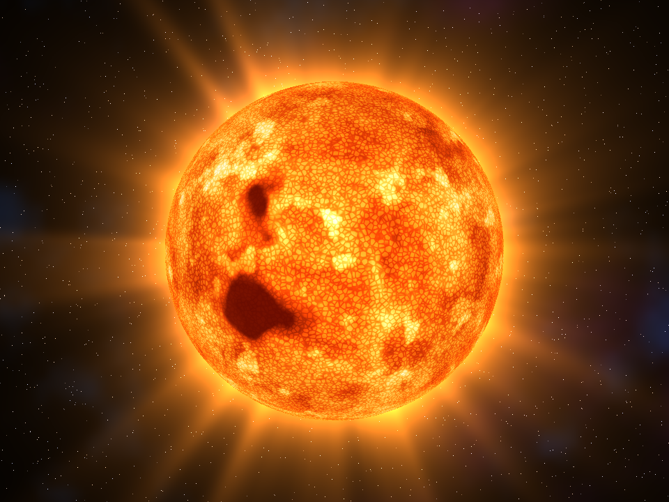
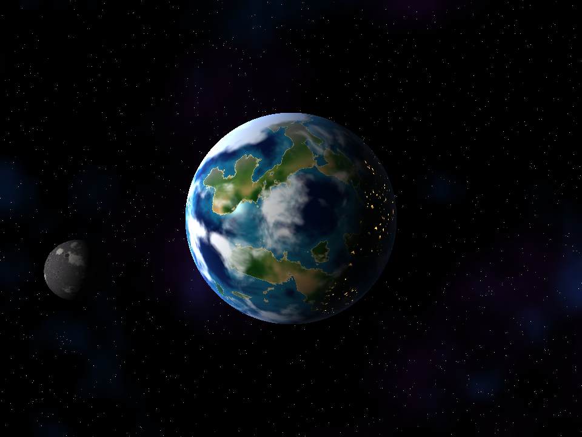
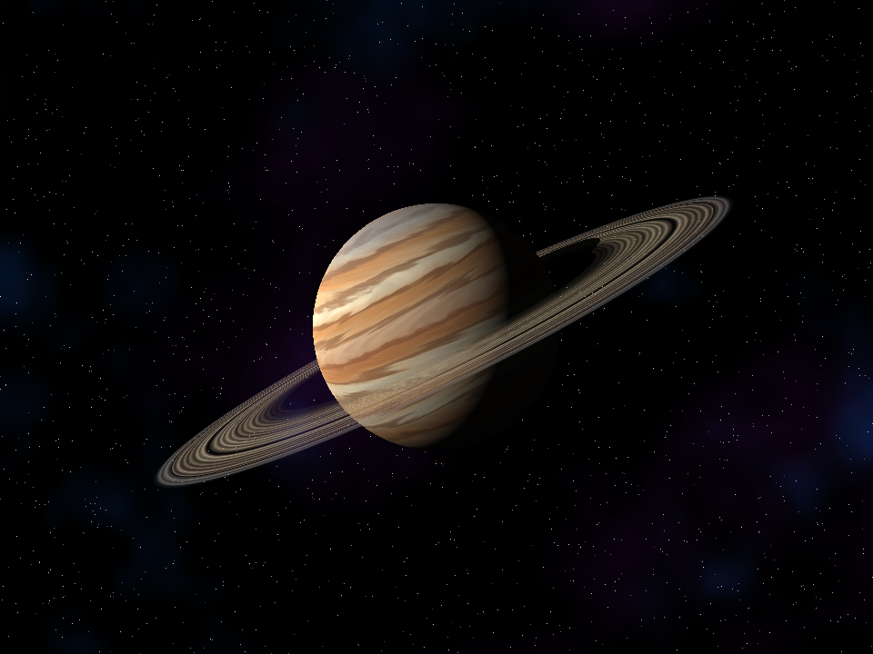
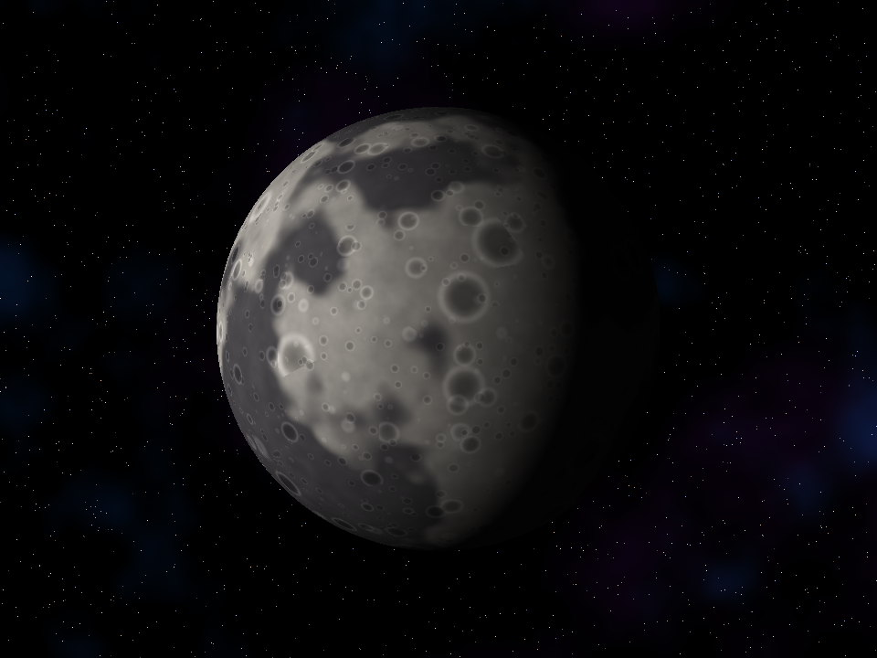
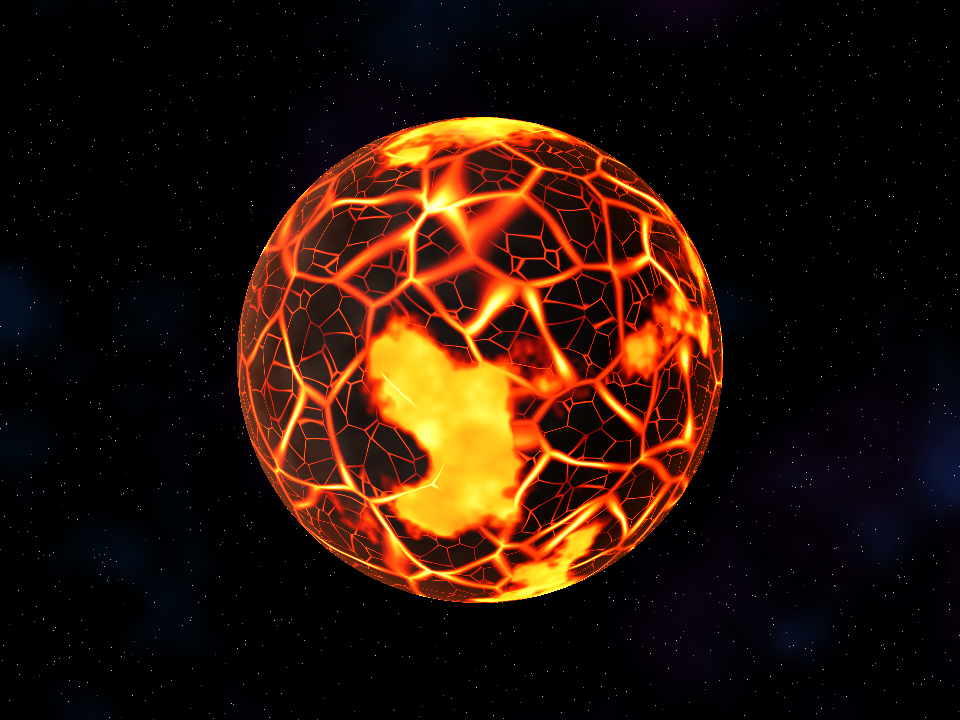
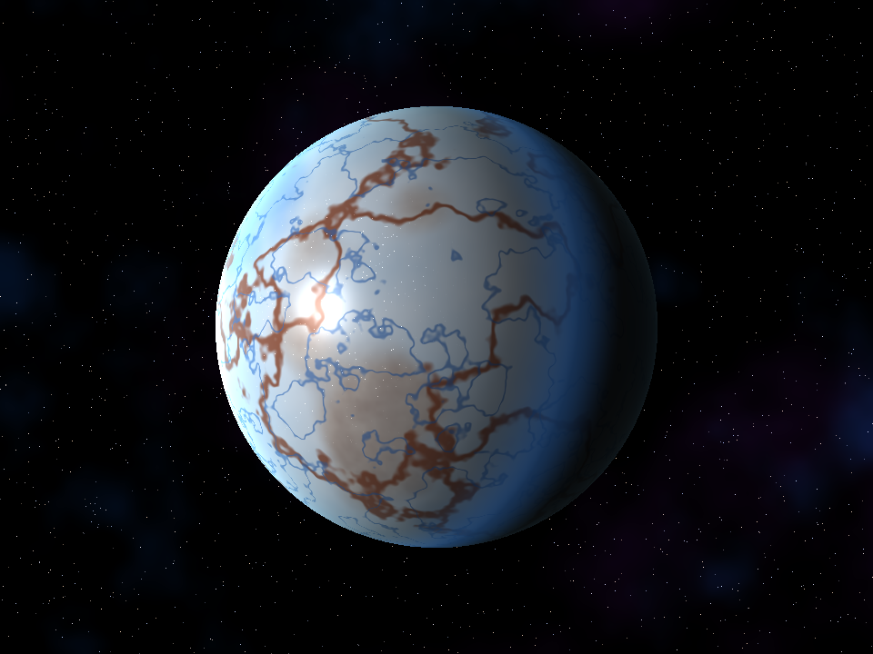
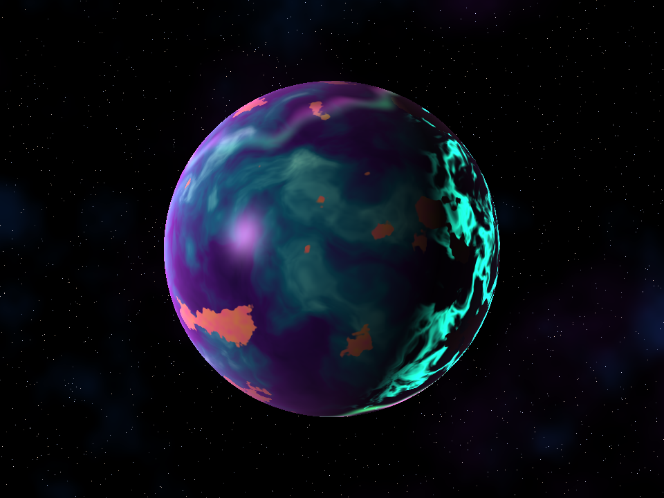
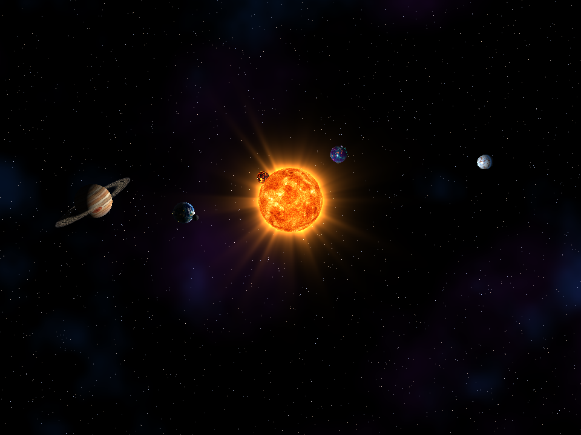

# Lab 5 - Shaders

Software renderer en Rust que dibuja un sistema solar completo usando únicamente shaders procedurales (sin texturas ni materiales). Todo el color se calcula por fragmento a partir de la posición sobre la esfera, la normal, la luz, la cámara y el tiempo.

## Ejecutar

```bash
cargo run --release
```

Generar los screenshots:

```bash
cargo run --release -- --capture
```

## Controles

| Tecla | Vista |
|-------|-------|
| `1` | Sol |
| `2` | Terra (planeta rocoso + luna) |
| `3` | Zephyria (gigante gaseoso + anillos) |
| `4` | Ignis (planeta de lava) |
| `5` | Glacies (luna helada) |
| `6` | Aurelia (océano alienígena) |
| `7` | Luna |
| `0` | Sistema solar completo (rotación y traslación) |
| `Espacio` | Pausa |
| `↑` / `↓` | Velocidad del tiempo |

## Cuerpos celestes

### Sol (estrella)


Capas: plasma turbulento con domain warping animado, granulación convectiva (voronoi), manchas solares con umbra y penumbra, fáculas brillantes, rampa de temperatura, oscurecimiento de limbo y corona animada con rayos alrededor de la estrella.

### Terra (planeta rocoso)


Capas: océanos con profundidad, continentes con playas, bosques, desiertos según humedad y latitud, tundra, montañas y nieve; casquetes polares; reflejo especular del sol en el océano; luces de ciudades en el lado nocturno; nubes animadas que rotan independientemente; atmósfera azul en el borde.

### Zephyria (gigante gaseoso)


Capas: bandas atmosféricas con rotación diferencial por latitud, turbulencia en las bandas, gran tormenta ovalada con remolino animado, neblina polar, sombra proyectada por los anillos sobre el planeta y halo atmosférico.

**Anillos**: modelo separado (anillo plano) con shader propio: densidad radial procedural, divisiones (huecos tipo Cassini y Encke), variación de color, transparencia, sombra del planeta sobre los anillos y dispersión hacia adelante.

### Luna


Modelo separado que orbita a Terra. Capas: mares oscuros, regolito, cráteres en tres escalas con fondo y borde iluminado, iluminación difusa.

### Planetas extra

#### Ignis (mundo de lava)


Corteza de basalto agrietada (voronoi con dos escalas), lava que pulsa en las grietas, mares de magma que fluyen, nubes de ceniza y resplandor incandescente en el borde.

#### Glacies (mundo helado)


Hielo con variaciones azules, terreno caótico, fracturas rojizas y grietas profundas azules, especular con destellos de escarcha, dispersión subsuperficial en el terminador y halo frío.

#### Aurelia (océano alienígena)


Océano violeta con corrientes en domain warping animadas, archipiélagos, bioluminiscencia en el lado nocturno, auroras polares animadas en forma de cortina y atmósfera rosada.

### Sistema solar


Todos los cuerpos rotan sobre su eje y se trasladan alrededor del sol, que es la fuente de luz de la escena. La luna orbita a Terra y los anillos acompañan a Zephyria.

## Concurso

Cuerpo enviado al concurso: **Terra**.
